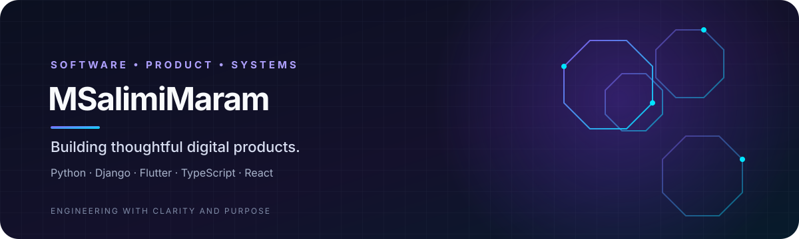

<!-- Profile README | maintained on the main branch -->

  

  <h1>Hi, I'm MSalimiMaram 👋</h1>
  
<strong>Software developer · Product-minded builder · Python / Django / Flutter</strong>

  

    I build practical digital products, from backend APIs and mobile applications to polished web experiences.
    My current flagship project is <strong>GAMva</strong> — a personal-growth platform shaped around meaningful progress, consistency, and user agency.
  

  

    
    
  

---

## About

- 🧭 **Product focus:** turning real-world needs into clear, maintainable software.
- 🧱 **Engineering focus:** backend architecture, API design, mobile apps, and thoughtful user experiences.
- 🌱 **Currently building:** GAMva / OctoLife, a platform designed to help people make progress across different areas of life.
- 🤝 **Open to:** thoughtful collaboration, practical feedback, and meaningful open-source contributions.

## Featured projects

<table>
  <tr>
    <td width="50%" valign="top">
      <h3><a href="https://gamva-preview.vercel.app/">GAMva — OctoLife Preview</a></h3>
      
A product and UI/UX preview for a personal-growth platform spanning routines, goals, challenges, learning, wellbeing, career, finances, and community.

      
  

      
<a href="https://github.com/msalimimaram/gamva-preview">Source repository →</a>

    </td>
    <td width="50%" valign="top">
      <h3>GAMva — Mobile & Backend</h3>
      
A Flutter mobile client and Django backend being developed as the application foundation for the GAMva product. These repositories are private; implementation details and readiness should not be inferred from the public preview alone.

      
  

      
<em>Private repositories — not publicly browsable.</em>

    </td>
  </tr>
  <tr>
    <td width="50%" valign="top">
      <h3><a href="https://github.com/msalimimaram/office_kmc">Office KMC</a></h3>
      
A software project focused on insurance operations and internal workflows.

      
<a href="https://github.com/msalimimaram/office_kmc">Explore repository →</a>

    </td>
    <td width="50%" valign="top">
      <h3>What I value</h3>
      
Readable code, useful documentation, maintainable architecture, honest delivery status, accessibility, and product decisions grounded in real user needs.

    </td>
  </tr>
</table>

## Tech stack

  

| Area | Tools & interests |
|---|---|
| Backend | Python, Django, REST API design |
| Mobile | Flutter, Dart |
| Web | React, TypeScript, Vite, Tailwind CSS |
| Engineering | Architecture, integration, testing, documentation, maintainability |
| Product | UX thinking, clear workflows, iterative delivery |

## Current focus: GAMva / OctoLife

GAMva explores personal growth through eight connected dimensions:

**Health · Learning · Financial wellbeing · Personal development · Career · Mental & emotional wellbeing · Challenge & entertainment · Overcoming fears**

The product principle is simple: help people keep moving forward without shame or punitive resets. Progress should remain visible, and the experience should respect user choice.

> The public preview communicates product direction and design intent; it is not a claim that every feature is already implemented or production-ready.

## Collaboration

I appreciate constructive code reviews, specific product feedback, and collaborations that solve meaningful problems. If something here interests you, open a discussion or issue in the relevant public repository.

  Built with curiosity, care, and an emphasis on steady progress.

